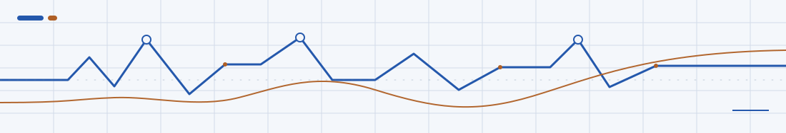

<picture>
  <source media="(prefers-color-scheme: dark)" srcset="./assets/engineering-signal-dark.svg">
  <source media="(prefers-color-scheme: light)" srcset="./assets/engineering-signal-light.svg">
  
</picture>

# Kelwin Feitosa

**Backend development · Java & Spring Boot · Python & automation**

I build backend systems and practical tools, with an emphasis on **clear domain models, testable business logic, reliable APIs, and maintainable code**. I'm also interested in the intersection of software, AI, and music technology.

**Brasília, Brazil** · Computer Science undergraduate at UDF (expected graduation: December 2027) · Interested in **internships and junior software engineering opportunities**, including remote international teams.

[Selected work](#selected-work) · [LinkedIn](https://www.linkedin.com/in/kelwinfeitosa/) · [Email](mailto:kelwinfeitosa@gmail.com) · [Português](./README.md)

---

## Selected work

### 01 / [Supermarket Management API](https://github.com/kelwin-feitosa/supermarket-management-api)

**Java 21 · Spring Boot 4 · PostgreSQL · Spring Security · Docker**

A modular REST backend for supermarket operations: product catalog, suppliers, inventory, procurement, shopping carts, sales, and user management.

- **Engineering focus:** feature-oriented modular monolith, validation, transactional business operations, JWT-based security, filtering and pagination.
- **Quality practices:** automated tests with JUnit/Mockito, API documentation, database tooling and GitHub Actions CI.
- **Stage:** actively evolving backend; the planned frontend and point-of-sale interface are not yet implemented.

[Explore architecture, setup and tests](https://github.com/kelwin-feitosa/supermarket-management-api#readme)

### 02 / [AI Finance Assistant](https://github.com/kelwin-feitosa/assistente-financeiro)

**Java 21 · Spring Boot · Spring AI · MySQL · Gemini**

An AI-assisted transaction API developed as a capstone project for the **Itaú / DIO Java + AI bootcamp**.

- **Engineering focus:** natural-language requests mapped to explicit application operations through tool calling, with domain services kept separate from the AI integration.
- **Additional interface:** a local speech pipeline using Whisper.cpp for transcription and Piper for speech synthesis.
- **Quality practices:** JUnit/Mockito tests and a GitHub Actions workflow backed by MySQL for CI.

[Explore implementation and limitations](https://github.com/kelwin-feitosa/assistente-financeiro#readme)

<strong>More public work</strong>

- [Java loan simulator](https://github.com/kelwin-feitosa/simulador-emprestimo-java) — credit rules and financial calculations with Java SE and `BigDecimal`; database persistence is still on the roadmap.
- [Exercism solutions](https://github.com/kelwin-feitosa/exercism) — Java exercises and deliberate practice in programming fundamentals.

## How I work

| Area | Experience and tools |
| --- | --- |
| **Backend** | Java, Spring Boot, Spring Data JPA, Hibernate, REST APIs, validation |
| **Data** | PostgreSQL, MySQL, relational modeling, Flyway |
| **Security & reliability** | Spring Security, JWT, transaction boundaries, exception handling |
| **Testing & delivery** | JUnit 5, Mockito, Maven, Docker, GitHub Actions, OpenAPI |
| **Beyond the Java stack** | Python for experimentation and automation; interest in AI integration and music-related software |

I value documenting architectural decisions, understanding trade-offs, and improving code through tests and refactoring.

## An interdisciplinary perspective

Alongside Computer Science, I trained in **transverse flute at the Escola de Música de Brasília**. Music has shaped my attention to structure, precision, and iterative practice. I'm particularly interested in software for **music notation, education, and computational music research**.

## Let's connect

I'm interested in practical engineering challenges, meaningful collaboration, and early-career opportunities in backend engineering, automation, and MusicTech.

**[LinkedIn](https://www.linkedin.com/in/kelwinfeitosa/)** · **[Email me](mailto:kelwinfeitosa@gmail.com)** · **[Browse repositories](https://github.com/kelwin-feitosa?tab=repositories)**

This profile prioritizes project evidence over activity counters. Project status and implementation details are documented in each linked repository.
