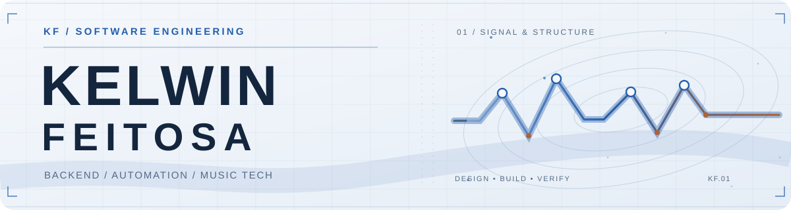
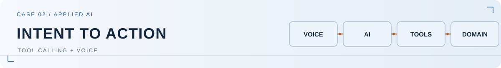
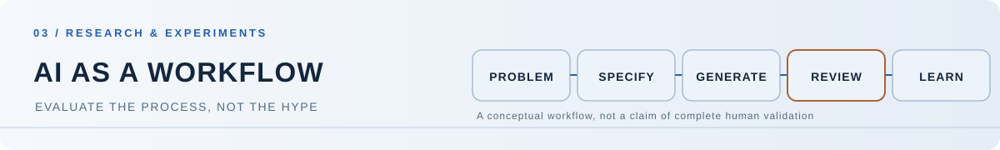

<picture>
  <source media="(prefers-color-scheme: dark)" srcset="./assets/signal-cartography-dark.svg">
  <source media="(prefers-color-scheme: light)" srcset="./assets/signal-cartography-light.svg">
  
</picture>

# Kelwin Feitosa

**Software development · AI-assisted engineering · Automation · MusicTech**

I work across **software development, artificial intelligence, and automation**. In engineering projects, I focus on APIs, domain models, and software quality; in personal experiments, I explore how AI agents turn requirements into implementations — and where that process falls short.

My work spans **Java and Spring Boot**, **Python**, and music technology. I distinguish publicly inspectable code from AI-assisted prototypes and integrations that have not yet been validated in real-world use.

**Brasília, Brazil** · Computer Science undergraduate at **UDF** (expected graduation: Dec 2027) · Interested in **internships, junior roles, and remote collaboration**, including international opportunities.

[**Public code**](#selected-work) · [**AI experiments**](#ai-development-experiments) · [LinkedIn](https://www.linkedin.com/in/kelwinfeitosa/) · [Email](mailto:kelwinfeitosa@gmail.com) · [**Português**](./README.md)

---

## Selected work

**Public code:** the repositories below let visitors inspect implementations, architecture, documentation, and tests directly.

### 01 · [Supermarket Management API](https://github.com/kelwin-feitosa/supermarket-management-api)

<picture>
  <source media="(prefers-color-scheme: dark)" srcset="./assets/case-systems-dark.svg">
  <source media="(prefers-color-scheme: light)" srcset="./assets/case-systems-light.svg">
  
</picture>

**Java 21 · Spring Boot 4 · PostgreSQL · Spring Security · Docker**

A REST API for supermarket operations, including catalog, suppliers, inventory, purchasing, shopping carts, and sales.

- **Engineering:** domain-oriented modular monolith, validation, transactional operations, JWT authentication, filtering, and pagination.
- **Evidence:** automated tests with JUnit and Mockito, API documentation, and continuous integration with GitHub Actions.
- **Current scope:** backend under active development; the admin interface and point-of-sale frontend remain planned.

[**Explore the code, architecture, and tests**](https://github.com/kelwin-feitosa/supermarket-management-api#readme)

### 02 · [AI Finance Assistant](https://github.com/kelwin-feitosa/assistente-financeiro)

<picture>
  <source media="(prefers-color-scheme: dark)" srcset="./assets/case-ai-dark.svg">
  <source media="(prefers-color-scheme: light)" srcset="./assets/case-ai-light.svg">
  
</picture>

**Java 21 · Spring Boot · Spring AI · MySQL · Gemini**

An AI-assisted transaction API built as the capstone for the **Itaú / DIO Java + AI bootcamp**.

- **Engineering:** tool calling delegates operations to application services, keeping AI integration separate from business rules.
- **Features:** creating and querying transactions, local transcription with Whisper.cpp, and speech synthesis with Piper.
- **Evidence:** JUnit/Mockito tests and a MySQL-backed CI pipeline. Natural-language interpretation relies on an external service.

[**Explore implementation and limitations**](https://github.com/kelwin-feitosa/assistente-financeiro#readme)

<strong>More public work and fundamentals</strong>

- [**Java loan simulator**](https://github.com/kelwin-feitosa/simulador-emprestimo-java) — credit-assessment rules, object-oriented design, and financial calculations using `BigDecimal`; PostgreSQL persistence is still planned.
- [**UDF academic projects**](https://github.com/kelwin-feitosa/UDF-Projetos) — mobile development exercises, interface prototyping, and graph-theory fundamentals.
- [**Exercism**](https://github.com/kelwin-feitosa/exercism) — Java fundamentals and deliberate coding practice.

## AI development experiments

<picture>
  <source media="(prefers-color-scheme: dark)" srcset="./assets/case-ai-lab-dark.svg">
  <source media="(prefers-color-scheme: light)" srcset="./assets/case-ai-lab-light.svg">
  
</picture>

These three projects are **personal experiments in heavily AI-assisted software development**. I used AI models to generate and evolve much of the implementation while exploring requirements, iteration management, and assessment of the results. The goal was to learn about **AI as a development workflow**, not to claim that I manually wrote every module.

Automated tests do not mean I have personally validated every workflow in real-world use. **All three repositories are public** so visitors can inspect the code, documentation, and known limitations; this does not mean the systems are validated for real-world use.

### 03 · [FluteOMR](https://github.com/kelwin-feitosa/FluteOMR) — music computing

**Python · image processing · MusicXML · experimental prototype**

- **Question:** how far can AI agents take a music-recognition system when guided by musical rules, corpus design, and technical evaluation?
- **Documented scope:** staff detection, controlled recognition components, experimental MusicXML export, and automated checks.
- **Limit:** reliable end-to-end transcription has not been demonstrated; independent musical references and human review remain limited.

### 04 · [Kelwin Hub](https://github.com/kelwin-feitosa/kelwin-hub) — local productivity and automation

**Python · FastAPI · SQLite · web interface · local pilot**

- **Question:** can an AI-assisted workflow evolve a multi-module product while retaining clear privacy and maintainability requirements?
- **Documented scope:** projects, tasks, contacts, opportunities, calendar, local alerts, authentication, and encrypted backups.
- **Limit:** not a validated production release; external integrations and automated third-party messaging are not part of the validated scope.

### 05 · [Aurora](https://github.com/kelwin-feitosa/Aurora) — academic automation and integrations

**TypeScript · PWA · Gmail/Outlook · pre-validation prototype**

- **Question:** how can an AI-assisted implementation identify academic commitments from email while retaining human review and privacy controls?
- **Documented scope:** provider integration code, synchronization and notification flows, an installable interface, and simulated-provider tests.
- **Limit:** real-account OAuth, deployment, and notification delivery still require validation; not a dependable sole source for deadlines.

**Publishing code is not a product release:** these experiments remain in development and should be evaluated in light of their documented limitations.

## Engineering approach

| Area | Tools and practices demonstrated in projects |
| --- | --- |
| **Backend and domain** | Java, Spring Boot, REST APIs, Spring Data JPA, Hibernate, validation |
| **Data** | PostgreSQL, MySQL, relational modeling, Flyway |
| **Reliability and security** | Spring Security, JWT, transactions, error handling, reviewing design constraints |
| **Testing and delivery** | JUnit 5, Mockito, Maven, Docker, GitHub Actions, OpenAPI |
| **AI-assisted development** | Requirements, iteration with agents, critical evaluation of outputs, experimental workflows |
| **Automation and MusicTech** | Python, local workflows, experimental integrations, MusicXML, music-related tools |

I care about **why** an engineering decision works. With AI-generated code, that also means scrutinizing agent outputs, acknowledging what was not tested, and separating evidence from assumptions rather than accepting generated code as automatically correct.

## Music and computing

I completed formal training in **concert flute at the Escola de Música de Brasília**. That background informs the questions I explore in music computing: score reading, **MusicXML**, optical music recognition, and music education. **FluteOMR** is an experiment at that intersection.

## Get in touch

I'm interested in early-career opportunities involving **software development, applied AI, automation, backend engineering, and MusicTech**.

**[LinkedIn](https://www.linkedin.com/in/kelwinfeitosa/)** · **[Email](mailto:kelwinfeitosa@gmail.com)** · **[Browse public repositories](https://github.com/kelwin-feitosa?tab=repositories)**

Engineering projects and AI-assisted experiments are clearly distinguished. No prototype is presented as production-ready software. Essential content remains readable without images or motion.
