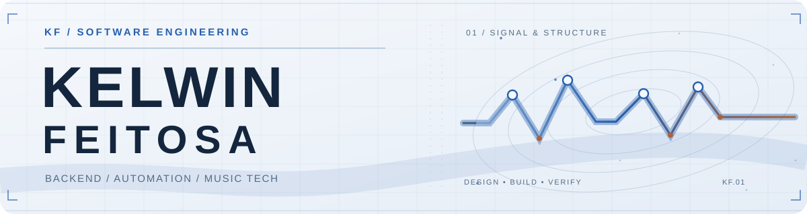
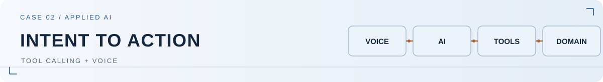

<picture>
  <source media="(prefers-color-scheme: dark)" srcset="./assets/signal-cartography-dark.svg">
  <source media="(prefers-color-scheme: light)" srcset="./assets/signal-cartography-light.svg">
  
</picture>

# Kelwin Feitosa

**Backend com Java e Spring Boot · Python e automação · Engenharia de software e computação musical**

Desenvolvo **APIs e ferramentas práticas** com atenção à modelagem de domínio, regras testáveis, integração entre sistemas e manutenção do código. Também exploro a relação entre software, inteligência artificial e notação musical.

**Brasília, Brasil** · Ciência da Computação na **UDF** (conclusão prevista para dez/2027) · Interesse em **estágios, vagas júnior e colaboração remota**, inclusive internacional.

[**Projetos selecionados**](#projetos-em-destaque) · [LinkedIn](https://www.linkedin.com/in/kelwinfeitosa/) · [E-mail](mailto:kelwinfeitosa@gmail.com) · [**Read in English**](./README.en.md)

---

## Projetos em destaque

### 01 · [Supermarket Management API](https://github.com/kelwin-feitosa/supermarket-management-api)

<picture>
  <source media="(prefers-color-scheme: dark)" srcset="./assets/case-systems-dark.svg">
  <source media="(prefers-color-scheme: light)" srcset="./assets/case-systems-light.svg">
  
</picture>

**Java 21 · Spring Boot 4 · PostgreSQL · Spring Security · Docker**

API para operações de supermercado, incluindo catálogo, fornecedores, estoque, compras, carrinhos e vendas.

- **Engenharia:** monólito modular por domínio, validação, operações transacionais, autenticação com JWT e consultas com filtros e paginação.
- **Evidências:** testes automatizados com JUnit e Mockito, documentação da API e integração contínua com GitHub Actions.
- **Estado real:** backend em evolução; interface administrativa e frente de caixa permanecem planejadas.

[**Ver código, arquitetura e testes**](https://github.com/kelwin-feitosa/supermarket-management-api#readme)

### 02 · [Assistente Financeiro com IA](https://github.com/kelwin-feitosa/assistente-financeiro)

<picture>
  <source media="(prefers-color-scheme: dark)" srcset="./assets/case-ai-dark.svg">
  <source media="(prefers-color-scheme: light)" srcset="./assets/case-ai-light.svg">
  
</picture>

**Java 21 · Spring Boot · Spring AI · MySQL · Gemini**

API de transações financeiras com solicitações em linguagem natural, desenvolvida como projeto final do **bootcamp Itaú / DIO — Java com Inteligência Artificial**.

- **Engenharia:** *tool calling* encaminha operações para serviços da aplicação, mantendo a integração com IA separada das regras de negócio.
- **Recursos:** criação e consulta de transações, transcrição local com Whisper.cpp e síntese de voz com Piper.
- **Evidências:** testes com JUnit/Mockito e pipeline de CI com MySQL. A interpretação de linguagem natural utiliza serviço externo.

[**Explorar implementação e limitações**](https://github.com/kelwin-feitosa/assistente-financeiro#readme)

<strong>Outros trabalhos públicos e fundamentos</strong>

- [**Simulador de empréstimo (Java SE)**](https://github.com/kelwin-feitosa/simulador-emprestimo-java) — regras de análise de crédito, orientação a objetos e cálculos com `BigDecimal`; persistência em PostgreSQL ainda planejada.
- [**Projetos acadêmicos — UDF**](https://github.com/kelwin-feitosa/UDF-Projetos) — exemplos de desenvolvimento mobile, prototipação de interfaces e fundamentos de grafos.
- [**Exercism**](https://github.com/kelwin-feitosa/exercism) — prática de fundamentos e resolução de exercícios em Java.

## Engenharia na prática

| Área | Tecnologias e práticas presentes nos projetos |
| --- | --- |
| **Backend e domínio** | Java, Spring Boot, APIs REST, Spring Data JPA, Hibernate e validação |
| **Dados** | PostgreSQL, MySQL, modelagem relacional e Flyway |
| **Confiabilidade e segurança** | Spring Security, JWT, transações, tratamento de erros e revisão de limites |
| **Testes e entrega** | JUnit 5, Mockito, Maven, Docker, GitHub Actions e OpenAPI |
| **Exploração interdisciplinar** | Python, automação, integração com IA e software voltado à música |

Procuro entender **por que** uma decisão técnica funciona: documentar compromissos, testar regras de negócio e evoluir sistemas sem perder legibilidade.

## Música e computação

Sou formado em **flauta transversal pela Escola de Música de Brasília**. A prática musical motivou meu interesse em ferramentas para partituras, **MusicXML**, reconhecimento óptico de notação e educação musical — uma área em que posso aproximar experiência como músico e desenvolvimento de software.

## Contato

Tenho interesse em contribuir com equipes de backend, automação e MusicTech em oportunidades de início de carreira.

**[LinkedIn](https://www.linkedin.com/in/kelwinfeitosa/)** · **[E-mail](mailto:kelwinfeitosa@gmail.com)** · **[Todos os repositórios públicos](https://github.com/kelwin-feitosa?tab=repositories)**

Projetos apresentados com seu estado atual e limitações documentadas. O conteúdo essencial permanece legível sem imagens ou animações.
